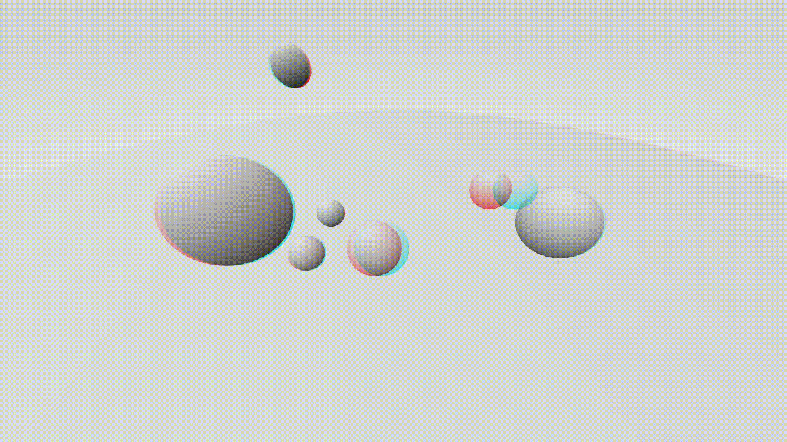

# First Homework

## Introduction

The codebase (`./src/`) is based on the 5th lecture version of the graphics engine, available [here](https://informatica.unibas.it/moodle/pluginfile.php/35971/mod_folder/content/0/Camera.zip?forcedownload=1).

This project implements camera system improvements:

- **Anaglyph stereogram** (medium difficulty)
- **Revolving camera point of view** (hard difficulty)

## 1. Anaglyph Stereogram

The red-cyan anaglyph is implemented by converting the left-eye and right-eye views to grayscale using PAL standard luminance weights (0.222 R + 0.707 G + 0.071 B).

To compose the stereogram, the left-eye luminance is assigned exclusively to the red channel, while the right-eye luminance is assigned to both the green and blue (cyan) channels. The method `toAnaglyph()` performs this channel isolation:

```C++
color toAnaglyph(color rayColor, bool isLeft) {
    // Each channel gets multiplied by a constant that mimics human perception of red, blue and green.
    float gray = 0.222f * rayColor[0] + 0.707f * rayColor[1] + 0.071f * rayColor[2];
    
    rayColor[0] = isLeft ? gray : 0.0f;
    rayColor[1] = isLeft ? 0.0f : gray;
    rayColor[2] = isLeft ? 0.0f : gray;

    return rayColor;
}
```

The rendering pipeline splits the viewpoint into two camera positions corresponding to the left and right eyes. The two viewpoints are separated by horizontal offset `e`, representing the interocular distance:

```C++
void render(const hittable& world, const bool toggle_anaglyph = false, const float e = 0.0) {
    ...
    if (toggle_anaglyph) {
        ray rr = get_ray(i, j, e);
        ray rl = get_ray(i, j, -e);
        pixel_color += toAnaglyph(ray_color(rl, world, true), true) + toAnaglyph(ray_color(rr, world, true), false);
    }
    ...
}

ray get_ray(int i, int j, float e = 0.0) const {
  // Get a randomly sampled camera ray for the pixel at location i,j.

  vec3 pixel_center = pixel00_loc + (i * pixel_delta_u) + (j * pixel_delta_v);
  vec3 pixel_sample = pixel_center + pixel_sample_square();

  point3 ray_origin = camera_center + 0.5 * e * pixel_delta_u;
  vec3 ray_direction = pixel_sample - ray_origin;

  return ray(ray_origin, ray_direction);
}
```

Because `e` is signed, inverting its sign reverses the parallax effect. A positive value produces a perceived pop-out effect in front of the screen, whereas a negative value creates depth receding into the screen.

Sample renders are available in `deliverables/`:
- `anaglyph@246px.bmp`: standard human interocular distance (~6.5 cm, ~246 px at 1280x720)
- `anaglyph@1%.bmp`: subtle depth effect (1% viewport width)
- `anaglyph@5%.bmp`: pronounced depth effect (5% viewport width)
- `inverted_anaglyph@246px.bmp`: standard human interocular distance (~6.5 cm, ~246 px at 1280x720)
- `inverted_anaglyph@1%.bmp`: subtle depth effect (1% viewport width)
- `inverted_anaglyph@5%.bmp`: pronounced depth effect (5% viewport width)

## 2. Revolving camera point of view

To achieve this, we implemented a revolving camera system using a Catmull-Rom spline path. 
...
The implementation followed three different parts:

### a. Implementation of `vec` and `matrix`

In order to achieve maximum optimization during Catmull-Rom spline point interpolation, we propose a matrix-based version as follows:

Given the time vector:
$$
T = \begin{bmatrix}
t^3 & t^2 & t & 1
\end{bmatrix}
$$

the control points vector:
$$
P = \begin{bmatrix}
P_0\\
P_1\\
P_2\\
P_3
\end{bmatrix}
$$

and finally the Catmull-Rom matrix:
$$
M_{CR} = {1\over2}\begin{bmatrix}
-1 & 3 & -3 & 1 \\
2 & -5 & 4 & -1 \\
-1 & 0 & 1 & 0 \\
0 & 2 & 0 & 0 \\
\end{bmatrix}
$$

The path time-based formula is:
$$
p(t) = T\cdot M_{CR}\cdot P
$$

This vectorized version makes our performance faster, since we can avoid directly using (nested) for loops, which is essential to our purpose.
To achieve this, we implemented `vec.h` to generalize vec3 to support N dimension and `matrix.h` to support NxM matrices, based on `vec` class as well.

#### `vec.h` implementation

We used C++17 [**fold expressions**](https://en.cppreference.com/cpp/language/fold) extensively to ensure lightning-fast performance.
Being a generalized version of `vec3`, we are going to analyze the `vec` class for differences.

1. Definition

```C++
template <std::size_t N>
class vec {
public:
  float e[N]{};
  ...
```

Adding a template unsigned size parameter makes array size allocation possible at compile time. To declare a, say, 7D vector: `vec<7> vec7{};`.

2. Operations

The class gives a definition for vector sum and vector-by-vector and scalar-by-vector product, as well as scalar product.
In particular, vector sums and vector-by-vector products have a shallow broadcasting mechanism, by always tossing away the excess elements from the larger matrix.

```C++
vec operator-() const {
    vec r = *this;
    return r *= -1.0f;
  }

  template <std::size_t M>
  vec& operator+=(const vec<M>& v) {
    unrolled_add(v, std::make_index_sequence<std::min(N, M)>{});
    return *this;
  }

  vec& operator*=(float t) {
    unrolled_mult(t, std::make_index_sequence<N>{});
    return *this;
  }

  template <std::size_t M>
  vec& operator*=(const vec<M>& v) {
    unrolled_mult(v, std::make_index_sequence<std::min(N, M)>{});
    return *this;
  }

  vec& operator/=(float t) {
    return *this *= 1 / t;
  }

  template <std::size_t M>
  float dot(const vec<M>& v) const {
    return unrolled_dot(v, std::make_index_sequence<std::min(N, M)>{});
  }
```

3. Unrolling

We could simply use for loops; however, since this is a graphical engine, performance is a key target. Although aware of the fact that this particular course is focused on offline rendering, we decided to yield a high-performance library anyway.

Loop unrolling is the practice of expanding a loop into a sequential chain of instructions to eliminate loop control overhead. In modern C++, we can achieve compile-time unrolling using C++17 Fold Expressions combined with std::index_sequence.
In the scalar product example, the compiler expands the parameter pack Is... into a single, flat expression at compile-time:

```C++
template <std::size_t M, std::size_t... Is>
float unrolled_dot(const vec<M>& v, std::index_sequence<Is...>) const {
    return ((e[Is] * v.e[Is]) + ...);
}
```

It functions identically to a MapReduce pattern:
- Map: (e[Is] * v.e[Is]) multiplies corresponding elements for each index;
- Reduce: The + ... syntax (a right fold) sums all the multiplied results together into a single scalar value without ever generating a runtime loop.

4. Inline functions

Just like `vec3`, `vec` gets its set of inline functions by exploiting self-assignment overridden operators.
For instance, defining inline vector product:
```C++
template <std::size_t N>
inline vec<N> operator*(vec<N> u, const vec<N>& v) {
  return u *= v;
}
```
Is just as convenient as reusing the `*=` overridden operator.

#### `matrix.h` implementation

`matrix` class takes advantage of the same paradigm explained above.
We regarded matrix as a simple list of row vectors, so that an $R\times C$ matrix is actually an array of size R of `vec<C>`.

```C++
template <std::size_t R, std::size_t C>
class matrix
{
public:
  vec<C> rows[R];
  ...
```

The implementation follows the same fashion as `vec`, using helpers for unrolling and overriding operators.
We provided the following operations:

- Sum of matrices of same size
- Scalar-by-matrix product
- Vector-by-matrix product and matrix-by-vector product
- Matrix-by-Matrix product
- Hadamard product (matrices of same size only)

Since most of these operations are reduced to vector operations, most of the complexity was managed by `vec` class in the first place.

Note: Catmull-Rom needs a **row vector** by matrix product. Since our matrix is naturally structured as an array of row vectors, implementing this was straightforward; a row vector of $N$ elements can be simply passed as a `vec<N>` to scale and sum the matrix rows. However, looking at our vector-by-matrix definition:

```C++

  //note: the accessor is private since is used by a public inline function
  template <std::size_t K>
  friend matrix<R, K> operator*(const matrix &A, const matrix<C, K> &B) 
  {
    return A.unrolled_product(B, std::make_index_sequence<R>{});
  }

  ...

  private:

  template <std::size_t... Is>
  vec<C> unrolled_vec_product(const vec<R> &v, std::index_sequence<Is...>) const
  {
    return ((v.e[Is] * rows[Is]) + ...);
  }
```

this already performs a linear combination of the matrix's rows, so that doing:

1. `matrix<1,4> * matrix<4,5>`
2. `vec<4> * matrix<4,5>`

is equivalent.

### b. Implementation of the spline.

We decoupled the computation of the spline into a separate `spline.h` header file.
The key idea is giving the renderer a list of `point3`s, which we defined in a `point3_list.h` header, as points where we'd like our camera to be at specific times.
While keeping the convenience of using a `point3`, used everywhere else in the codebase, we also need a way to convert a `point3` into a `vec<3>` for vectorized computation of Catmull-Rom spline. We have provided these conversion methods in both `vec.h` and `matrix.h`:
```C++
//vec.h

inline vec<3> fromVec3(vec3 v3) {
    return vec<3>{v3.x(), v3.y(), v3.z()};
}

inline vec3 toVec3(vec<3> v) {
    return vec3(v[0], v[1], v[2]);
}

//matrix.h

template <std::size_t R>
inline matrix<R, 3> fromPoint3List(const point3_list& l) {
    matrix<R, 3> m{};
    for (std::size_t i = 0; i < R; i++) {
        m.rows[i] = fromVec3(l.points.at(i));
    }
    return m;
}

template <std::size_t R>
inline point3_list toPoint3List(const matrix<R, 3>& m) {
    point3_list l{};
    for (std::size_t i = 0; i < R; i++) {
        l.add(toVec3(m.rows[i]));
    }
    return l;
}
```

To calculate the spline, we used a wrapper function, which prepares the control points vector to obtain a set that is consistent for obtaining a closed curve for our camera.

```C++
//note: path is an alias for point3_list
inline path catmull_rom_interpolate(const point3_list& controlSet, const float dt) {
   int size = controlSet.length();

   point3_list positions{ controlSet.points.back() };
   positions.add(controlSet);
   positions.add(controlSet.points[0]);
   positions.add(controlSet.points[1 % size]);

   ...
```

Then we declare the Catmull-Rom matrix:

```C++
matrix<4,4> M_CR = 0.5f * matrix<4, 4>{{{-1, 3, -3, 1}, { 2, -5, 4, -1 }, { -1, 0, 1, 0 }, { 0, 2, 0, 0 }}};
```

We need to calculate the time vector as well. To have a complete trajectory, our time vector needs to be interpolated by incrementing time by small amounts.
By tweaking the `dt` parameter, we can decide the trajectory density. A value closer to $\epsilon$ (`float dt = epsilon`, being `epsilon` a constant float value defined into `common.h`) means our spline is finer, while a value closer to 1 means it's coarser.

Everything is now ready for the closed spline to be calculated.
Since we are taking into account more than 4 points, we can use a moving window of four points at a time to generate a first spline. Then, by sliding the window forward by one point, we calculate the spline again, adding the result to our resulting set of points (path), then sliding the window forward by one position, and so on.

This happens all at once in place, inside a for loop:

```C++
    ...
    int segments = positions.length() - 3;
    for (int i = 0; i < segments; i++) {
        matrix<4, 3> controlSubset{ fromVec3(positions.points[i]), fromVec3(positions.points[i + 1]), fromVec3(positions.points[i + 2]), fromVec3(positions.points[i + 3]) };
        for (float t = 0.0f; t < 1.0f; t += dt) {
            vec<4> T{ t * t * t, t * t, t, 1 };
            pathPoints.add(toVec3(T * M_CR * controlSubset));
        }
        pathPoints.add(toVec3(T * M_CR * controlSubset));
    }
    ...
```

### c. Moving the camera and generating the numbered frames

We got everything now. Moving the camera means:

- Calculating the trajectory once at fixed density
- Cycling through each point of the trajectory
- For each point, render the scene and updating the window

Since we need to create a short footage of 10 seconds at 25 fps, we need to set our time increment `dt` based on the number of frame we want, by taking in account the number of segments as well. In our case, we need 250 frames in total:

```C++
point3_list camPositions;
// Here we define 6 points, which is exactly 6 segments because it's a closed curve.
...

float dt = (camPositions.length() * 1.0f)/250.0f;

path camPath = catmull_rom_interpolate(camPositions, dt);
```

Then, moving the camera means just moving `cam.lookfrom` to each point of the trajectory.
An essential step is to set again `camera_center`. To do that, we provided an helper method to set this private field.

```C++
for (int i = 0; i < size(camPath.points); i++) {
	point3 pos = camPath.points[i];
	cam.lookfrom = pos;
	cam.updateCameraPosition();

  //cam.render(world, true, e);
	cam.parallel_render(world, true, e);

	SDL_RenderPresent(renderer);

  // Saving the numbered frames: the rendering is too slow to save directly.
  // Footage gets mounted using ffmpeg tool with fixed framerate.

	stringstream s;
	s << "C:\\Users\\seman\\Desktop\\Homework-FdGT\\I\\savedFrames\\" << i + 1 << ".bmp";
	string filepath = s.str();

	saveScreenshotBMP(filepath);
}
```

Ending up with 252 images, which is at least 10 seconds of footage.




### 3. Extra Achievements

These are extra features we brought into the project as an extra:

#### Unblocking animation rendering

We need a way to keep main thread listening to events whilst rendering the animation.
Since the animation happen in for loop, which is blocking, we needed an unblocking solution.
We first thought of using a completely separated thread for animation rendering; however, being `SDLRenderer` non-thread safe, we would have faced a race condition risk.
So, we decided to not use a for loop at all, by rendering each frame and then listening to events inside the main loop:

```C++
SDL_Event event;
int frame_index = 0;
while (SDL_PollEvent(&event) || (!quit)) {

	if(!rendered) {
		if (toggle_animation) {
      // Ensure animation keep looping until explicit stopping by the user
			if (frame_index > camPath.points.size() - 1) {
				frame_index = 0; 
				if (enable_recording) {
          // When a cycle has completed, no need to keep recording frames 
					cout << "Recording complete."; 
					enable_recording = false;
				}
			}
			cam.lookfrom = camPath.points.at(frame_index);
			cam.updateCameraPosition();
			cam.parallel_render(world, toggle_anaglyph, e);
			SDL_RenderPresent(renderer);
			if (enable_recording) {
				saveCurrentFrame(frame_index);
			}
			frame_index++;
		}
		else {
			cam.parallel_render(world, toggle_anaglyph, current_e);
			SDL_RenderPresent(renderer);
			rendered = true;
		}
	}

	switch (event.type) {
    // Manage keyboard events here
    ...
  }
}
```

#### Function keys

Aside screenshots, we also brought animation toggling, anaglyph toggling and auto frame image saving toggling (during animation rendering) as well.

```C++
// Flags for function keys control
int frame_index = 0;
bool rendered = false;
bool is_rendering = false;
bool toggle_animation = false;
bool toggle_anaglyph = true;
bool enable_recording = true;
float current_e = e;
bool quit = false;

switch {
  ...
  case SDLK_a:
    current_e = toggle_anaglyph ? 0 : e;
    toggle_anaglyph = !toggle_anaglyph;
    rendered = false;
    break;

  case SDLK_r:
    enable_recording = !enable_recording;
    cout << (enable_recording ? "Auto frame saving enabled." : "Auto frame saving disabled.") << endl;
    break;

  case SDLK_SPACE:
    frame_index = 0;
    toggle_animation = !toggle_animation;
    is_rendering = !is_rendering;
    rendered = false;
    break;
  ...
}
```

#### Camera controls

We added keymappings to add vectors to `cam.viewfrom`:

- `h`: moves camera forward (adds $\left[0,0,0.5\right]$) 
- `j`: moves camera backwards (adds $\left[0,0,-0.5\right]$) 
- `k`: moves camera left (adds $\left[0.5,0, 0\right]$) 
- `l`: moves camera right (adds $\left[-0.5,0,0\right]$) 
- `,` key: moves camera up (adds $\left[0,0.5,0\right]$) 
- `.` key: moves camera down (adds $\left[0,-0.5,0\right]$) 
