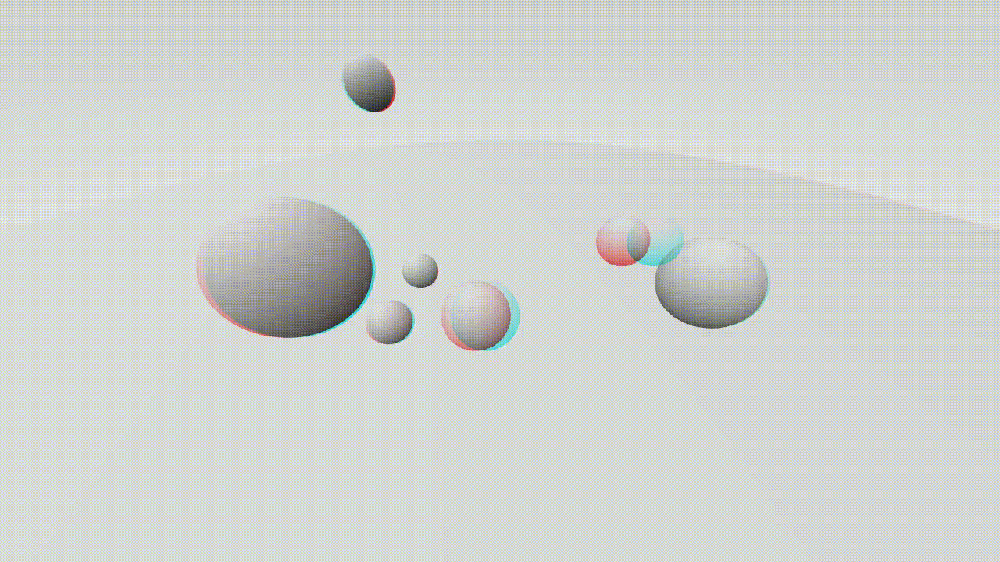
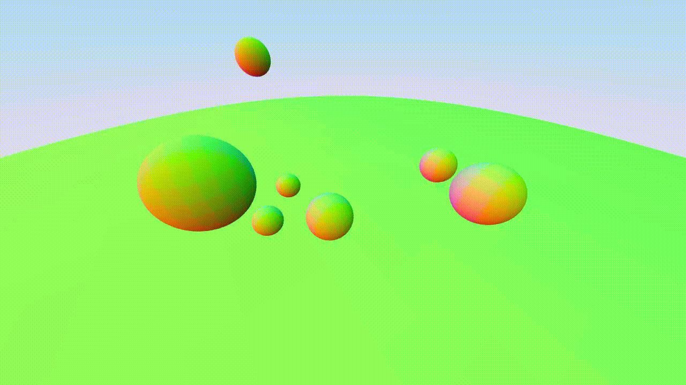

# Homework FdGT

This repo is a journal for the 3D Graphics Fundamentals course (University of Basilicata) for the 2026/2027 academic year.

---

## First Homework

In this homework (refer to [I/](./I/)), we experimented with camera improvements, introducing:

- **3D Anaglyph rendering**: executed via two sequential render passes in the viewport for a left (red) and right (cyan) camera. Tweaking the interocular distance value and sign controls the intensity and inversion of the 3D effect.
- **Camera Animation**: interpolated along a Catmull-Rom spline from specified camera positions using high-performance vectorized calculations via custom vector and matrix utility classes. Each frame can be saved and assembled into video footage with FFmpeg to produce 10 seconds of footage at 25 fps.
- **Control Improvements**: implemented non-blocking animation rendering within the main event loop, allowing the main thread to listen for keyboard events. Added *camera controls* for near real-time movement, *anaglyph toggling* to enable/disable the 3D effect, *frame recording toggles*, and *animation toggling*.

[Full documentation](./I/README.md)

<div style="display:flex; flex-direction: row; gap:16px; padding-top:8px;">
    
    
</div>

---

## Linux Development Setup (Cross-Compiling for Windows)

To develop, compile, and run Windows targets on Linux using JetBrains Rider (or the CMake CLI):

### 1. Prerequisites
Install `mingw-w64`, SDL2 MinGW development libraries, and Wine:
- **Debian / Ubuntu**:
  ```bash
  sudo apt install mingw-w64 libsdl2-mingw-dev wine wine-binfmt
  ```
- **Fedora**:
  ```bash
  sudo dnf install mingw64-gcc-c++ mingw64-SDL2 wine
  ```
- **Arch Linux**:
  ```bash
  sudo pacman -S mingw-w64-gcc mingw-w64-sdl2 wine
  ```

*(Note: `wine-binfmt` registers `.exe` files with the Linux kernel so they can be run directly from Rider or the terminal).*

### 2. Generate CMake & Rider Configurations
Run `gen_cmake.sh` with the project directory name (e.g. `I`, `II`):
```bash
./scripts/gen_cmake.sh [-f] <PROJECT>
```

This automatically:
- Parses the project's Visual Studio project file (`<PROJECT>/src/*.vcxproj`).
- Generates `<PROJECT>/src/CMakeLists.txt` targeting Windows x64.
- Configures MinGW toolchain fallback, OpenMP parallelization, and SDL2 linking.
- Emits the OpenMP `ppl.h` cross-compilation shim in `<PROJECT>/src/` if needed.
- Automatically copies all required runtime DLLs (`SDL2.dll`, `libgomp-1.dll`, etc.) alongside the binary on build.
- Creates shared JetBrains Rider Run Configurations in `<PROJECT>/src/.run/` (`<Target> (Release)` and `<Target> (Debug)`).

### 3. Build & Run
- **In JetBrains Rider**: Open `<PROJECT>/src` as a project. Select either `<Target> (Release)` or `<Target> (Debug)` from the Run Configurations dropdown and click **Run**.
- **Via CLI**:
  ```bash
  cmake -S <PROJECT>/src -B build -DCMAKE_BUILD_TYPE=Release
  cmake --build build
  wine build/<Target>.exe
  ```

---

## Exporting for Delivery

Package any homework project into a delivery-ready zip archive:

- **Linux / macOS**:
  ```bash
  ./scripts/export.sh <PROJECT> <ARCHIVE_NAME>
  ```
- **Windows (CMD / PowerShell)**:
  ```cmd
  .\scripts\export.bat <PROJECT> <ARCHIVE_NAME>
  ```

Example:
```bash
./scripts/export.sh I Camera_delivery
# or on Windows:
.\scripts\export.bat I Camera_delivery
```

Generates `scripts/outputs/<ARCHIVE_NAME>.zip` structured as:
- `src/`: source code filtered via repository root `.deliverignore` (and optional `<PROJECT>/.deliverignore`).
- `screenshot/`: image deliverables (`.bmp`, `.png`, `.jpg`, etc.).
- `video/`: video deliverables (`.mp4`, `.mov`, etc.).
- `eseguibili/`: compiled Windows executables from `<PROJECT>/src/<Solution>/Release/x64/` (or `.exe` and `.dll` files from `cmake-build-release/` on Linux).
- Root: `README.txt` and `.html` files from `<PROJECT>/deliverables/`.